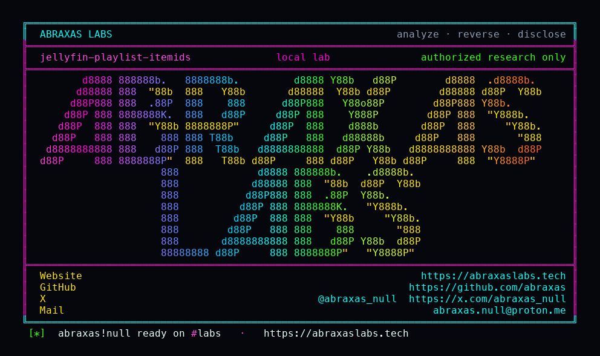

<p align="center">
  
</p>

<p align="center">
  <a href="https://abraxaslabs.tech"><strong>abraxaslabs.tech</strong></a>
  &nbsp;·&nbsp;
  <a href="https://github.com/abraxas">github.com/abraxas</a>
  &nbsp;·&nbsp;
  <a href="https://x.com/abraxas_null">@abraxas_null</a>
  &nbsp;·&nbsp;
  <a href="mailto:abraxas.null@proton.me">abraxas.null@proton.me</a>
  &nbsp;·&nbsp;
  <a href="https://github.com/abraxas/jellyfin-playlist-itemids">jellyfin-playlist-itemids</a>
</p>

# jellyfin-playlist-itemids

**Class:** IDOR
**Reach:** Remote (any user who can see a public playlist)

**Jellyfin Server** `v12.2` (`ca0f16eb7c195f720a1493ed469a27c4657db0c6`) - Jellyfin

[GHSA-9x85](https://github.com/jellyfin/jellyfin/security/advisories/GHSA-9x85-gx46-6522) patched `GET /Playlists/{id}/Items` with `GetUserId` plus `Where(i => i.Item2.IsVisible(user))`. [`GET /Playlists/{id}`](https://github.com/jellyfin/jellyfin/blob/v12.2/Jellyfin.Api/Controllers/PlaylistsController.cs) was not given that filter. `ItemIds` is `GetManageableItems()` with **no** `IsVisible` on children. `GetPlaylistForUser` only requires playlist visibility.

`CreatePlaylistDto.IsPublic` defaults **true**. OpenAccess playlists are `IsVisible` to other users (`HasParentalAllowedChild` still lets a second user see the playlist). Unauth `GET /Videos/{id}/stream` has no `[Authorize]`. `StreamingHelpers` loads `GetItemById` without a user.

**A user who can see a public playlist reads private child GUIDs from `ItemIds`, then streams the files with no token.**

| | |
|---|---|
| ID | no CVE yet |
| Class | **IDOR** (playlist ItemIds leftover of GHSA-9x85, then unauth stream) |
| Reach | **Remote** (any user who can see a public playlist) |
| CWE | [CWE-639](https://cwe.mitre.org/data/definitions/639.html), [CWE-862](https://cwe.mitre.org/data/definitions/862.html) |
| CVSS | **High: 6.5** `CVSS:3.1/AV:N/AC:L/PR:L/UI:N/S:U/C:H/I:N/A:N` |
| Product | [Jellyfin Server](https://github.com/jellyfin/jellyfin) |
| Affected | **v12.2** (`ca0f16eb`) image `jellyfin/jellyfin:12.2` |
| Auth | authenticated for the playlist GET; none for the stream |
| License | [GNU Affero GPL v3.0](LICENSE) |
| Lab | `127.0.0.1:18800` only |

Leftover **#3** of [Jellyfin 12.2 leftovers](https://abraxaslabs.tech/research/jellyfin-12.2-leftovers). Leftover #1 (most important): [jellyfin-suggestions-idor](https://github.com/abraxas/jellyfin-suggestions-idor). Same pin: [jellyfin-svg-gzip](https://github.com/abraxas/jellyfin-svg-gzip) · [jellyfin-ffmpeg-colonslash](https://github.com/abraxas/jellyfin-ffmpeg-colonslash).

## What an attacker can do

Victim and attacker are two users on one server with disjoint libraries (kids vs adults, or a hidden folder). Victim puts a private movie on a public playlist. Body-create `IsPublic` defaults true, so that is the usual case, not a share. Attacker logs in as a restricted account, reads the playlist object, then fetches the file with no `Authorization` header.

This is GUIDs of media in libraries the attacker is not assigned, then the full file via stream. It is not playlist-title enum. Add/create still drop non-visible items.

### Recon (lab-proven)

| Method | Path | Privilege |
|---|---|---|
| GET | `/Playlists/{playlistId}` | Child GUIDs of a visible playlist (`ItemIds` from `GetManageableItems()`, no `IsVisible` on children). Also `Shares[].UserId` / `CanEdit` (sharee userIds). Lab: B's `GET /Playlists/{id}/Items` empty; same id's `GET /Playlists/{id}` listed private GUID `a2bf95146e44897be6fb09020a82eb52`. |

`GetPlaylistForUser` only requires the playlist itself to be visible. OpenAccess plus `HasParentalAllowedChild` (which skips the allowed-tag check) is enough. The patched Items route is the control: it still filters.

### Confidentiality (lab-proven)

| Method | Path | Privilege |
|---|---|---|
| GET | `/Videos/{itemId}/stream?static=true` | Private media bytes. **No `[Authorize]`.** `StreamingHelpers` does `GetItemById<BaseItem>(id)` without a user. Lab: unauth 200, 1142 bytes, witness `JELLYFIN-PLAYLIST-ITEMIDS-WITNESS` in the body. |
| GET | `/Audio/{itemId}/stream` | Same sink for audio. Same helper, same unscoped lookup. |

Authenticated HLS `GET /Videos/{itemId}/master.m3u8` is the same `GetItemById` path (`DynamicHlsController` has class-level `[Authorize]`). Lab exercised the unauth progressive stream, not HLS.

### Integrity (closed)

| Method | Path | Privilege |
|---|---|---|
| POST | `/Playlists/{id}/Items` and create `Ids` | Closed. `Playlist.GetPlaylistItems` runs `IsVisible`. Private GUIDs are dropped, not linked. |

### Adjacent surface that stays closed

- Adding private GUIDs to your own playlist.
- InstantMix (user-scoped `GetItemById(id, user)`).
- Collections (`EnableCollectionManagement` default false; `FilterLinkedChildrenPerUser`).
- GHSA-hw73 transcode prefix (`ValidateTranscodePath` keeps legacy HLS segments inside the transcode dir).
- GHSA-9x85 `userId` impersonation on Items (`GetUserId` 403s a foreign id).
- `GET /Playlists/{id}/Items` listing of private children (the patched route; lab `items-filtered=yes`).

No password/policy write. No plugin install. No shell.

Folder ACL (`EnabledFolders`) alone did **not** hide the child on `/Items` in this lab. `AllowedTags=["lab-public"]` made `IsVisible` drop it. `ItemIds` and unauth stream do not consult that filter.

## How I found it

I pinned [jellyfin/jellyfin](https://github.com/jellyfin/jellyfin) **v12.2** (`ca0f16eb`). Twenty source hunts on leftovers of the 12.0 GHSA wave. GHSA-9x85 taught `GetPlaylistItems` to filter children. I asked whether `GetPlaylist` got the same `Where`. It did not. Stream endpoints never received a user-scoped `GetItemById`.

Wrong turn: treating `EnabledFolders` as the Items hide. Movie `IsVisible` is parental/tags, not folder ACL. The lab had to set `AllowedTags` so the patched Items route would go empty. That is the control. The leftover does not use it.

## Lab

```bash
git clone https://github.com/abraxas/jellyfin-playlist-itemids
cd jellyfin-playlist-itemids
python3 jellyfin-playlist-itemids-Abraxas-Labs.py
```

Or:

```bash
cd lab
./run.sh
```

Target **only** `http://127.0.0.1:18800`. Image `jellyfin/jellyfin:12.2`. `run.sh` seeds two tiny mp4s (PrivateA witness filename, PublicB dummy). Wizard creates `labadmin`, both folders, then `labuser` with `EnableAllFolders=false`, `EnabledFolders=PublicB`, `AllowedTags=["lab-public"]`. Admin puts the private movie on a public playlist. Loopback. Witness-only. Requires Docker and `ffmpeg` to seed.

```text
SUCCESS JELLYFIN-PLAYLIST-ITEMIDS items-filtered=yes itemids-leak=yes unauth-stream=200 openAccess=yes playlist=e4798134497195ff4733dde62428e8d8 private=a2bf95146e44897be6fb09020a82eb52 witness-in-stream=yes witness-in-playlist-json=yes JELLYFIN-PLAYLIST-ITEMIDS-WITNESS
```

Replay: `python3 jellyfin-playlist-itemids-Abraxas-Labs.py`.

## Fix

Filter `ItemIds` with `IsVisible(user)`, matching `GetPlaylistItems`. Scope stream `GetItemById` to a user, or put `[Authorize]` on `VideosController.GetVideoStream` (and the audio sibling).

## References

- [github.com/jellyfin/jellyfin](https://github.com/jellyfin/jellyfin) tag [v12.2](https://github.com/jellyfin/jellyfin/releases/tag/v12.2) commit `ca0f16eb7c195f720a1493ed469a27c4657db0c6`
- [`PlaylistsController.GetPlaylist`](https://github.com/jellyfin/jellyfin/blob/v12.2/Jellyfin.Api/Controllers/PlaylistsController.cs) (`:163-182`) · `GetPlaylistItems` (`:524-541`)
- [`Playlist.GetManageableItems`](https://github.com/jellyfin/jellyfin/blob/v12.2/MediaBrowser.Controller/Playlists/Playlist.cs) · `CreatePlaylistDto.IsPublic`
- [`StreamingHelpers`](https://github.com/jellyfin/jellyfin/blob/v12.2/Jellyfin.Api/Helpers/StreamingHelpers.cs) · [`VideosController.GetVideoStream`](https://github.com/jellyfin/jellyfin/blob/v12.2/Jellyfin.Api/Controllers/VideosController.cs)
- Nearby patched (not this GET): [GHSA-9x85-gx46-6522](https://github.com/jellyfin/jellyfin/security/advisories/GHSA-9x85-gx46-6522) playlist Items `userId` IDOR
- Same pin: [jellyfin-suggestions-idor](https://github.com/abraxas/jellyfin-suggestions-idor) · [jellyfin-svg-gzip](https://github.com/abraxas/jellyfin-svg-gzip) · [jellyfin-ffmpeg-colonslash](https://github.com/abraxas/jellyfin-ffmpeg-colonslash)
- Series: [Jellyfin 12.2 leftovers](https://abraxaslabs.tech/research/jellyfin-12.2-leftovers)
- [CWE-639](https://cwe.mitre.org/data/definitions/639.html) · [CWE-862](https://cwe.mitre.org/data/definitions/862.html)

## License

GNU Affero GPL v3.0. See [LICENSE](LICENSE). Loopback lab only. No warranty.
